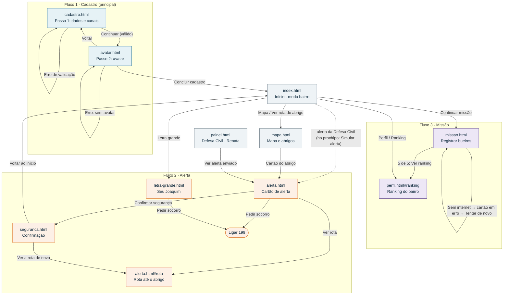

# Cidade Resiliente · Fluxos, componentes e navegação

Sprint 2 · Front-End Design · grupo Digital Nomads

Protótipo publicado: https://deboracgs.github.io/challenge-digital-nomads-2026/ · Repositório: https://github.com/Deboracgs/challenge-digital-nomads-2026 · Design system (Sprint 1): https://claude.ai/artifact/G4qN849nvuuydiSgA1apmD

Este documento cobre o critério 1 (Fluxos e Arquitetura): os três fluxos principais, os componentes de cada página com os nomes do design system e o fluxograma de navegação.

---

## 1. Os três fluxos principais

### Fluxo 1 (principal) · Cadastro do morador

| | |
|---|---|
| **Perfil do usuário** | Cláudia, moradora do Parque Burnier, uma área de encosta. Usa o celular para tudo, mas tem pouco tempo. Ela também cuida do filho, Lucas, e do vizinho, Seu Joaquim. |
| **Tarefa** | Criar a conta para receber alertas da Defesa Civil no celular e entrar na rede de vigias do bairro. |
| **Telas** | `cadastro.html` → `avatar.html` → `index.html` |

**Caminho principal**
1. No cadastro (passo 1 de 2), Cláudia preenche nome, celular com DDD e bairro, e escolhe pelo menos um canal de alerta (notificação no app, SMS ou ligação de voz).
2. Ela toca em **Continuar** e vai para a escolha de avatar (passo 2 de 2).
3. Escolhe um avatar e toca em **Concluir cadastro**.
4. Chega ao início, onde é chamada pelo nome e vê o avatar no chip de perfil.

**Caminhos alternativos**
- **Voltar:** o botão Voltar, nos dois passos, retorna à tela anterior.
- **Referência opcional:** o campo "Rua ou ponto de referência" pode ficar em branco.
- **Mais de um canal:** dá para marcar vários canais ao mesmo tempo.
- **WhatsApp:** aparece desabilitado ("Em breve"), para mostrar que o canal está previsto.

**Pontos de falha e como a interface responde**

| Falha | Resposta |
|---|---|
| Campo obrigatório vazio | Mensagem com ícone e texto abaixo do campo, borda de erro e `aria-invalid="true"`. O foco vai para o primeiro campo com problema. |
| Celular sem DDD ou com dígitos a mais/menos | "Digite o celular com DDD. Exemplo: (32) 99999-0000." |
| Nenhum canal de alerta escolhido | Erro no grupo inteiro: "Escolha pelo menos um jeito de receber os alertas." |
| Nenhum avatar escolhido | Erro no seletor: "Escolha um avatar para continuar." |
| A pessoa corrige o campo | O erro some na hora, sem enviar de novo. |
| Navegador bloqueia o armazenamento | O fluxo continua e o início mostra os dados de exemplo. |

### Fluxo 2 · Receber um alerta e chegar ao abrigo

| | |
|---|---|
| **Perfil do usuário** | Cláudia, durante uma chuva forte à noite. Está com pressa e nervosa, talvez sem internet. Caminho alternativo: Seu Joaquim, idoso, com baixa visão e sem smartphone. |
| **Tarefa** | Entender o risco, saber o que fazer, chegar ao abrigo e avisar que está em segurança. |
| **Telas** | `alerta.html` → `alerta.html#rota` → `seguranca.html` |

**Caminho principal**
1. O alerta chega. No protótipo, ele é simulado pelo link "Simular alerta" no rodapé.
2. O cartão de alerta mostra o nível (forma + cor + palavra), o que fazer agora e o abrigo mais próximo.
3. **Ver rota até o abrigo** leva ao mapa da rota a pé.
4. **Confirmar que estou em segurança** leva à confirmação, que mostra quem da rede de vizinhos já foi avisado.
5. **Voltar ao início.**

**Caminhos alternativos**
- **Pedir socorro:** o botão no topo de todas as telas do modo alerta liga para a Defesa Civil (`tel:199`).
- **Modo letra grande (Seu Joaquim):** `letra-grande.html` traz o status em tamanho grande, o botão **Ouvir aviso** (que lê o aviso em voz alta) e o botão **Ligar para a Cláudia**.
- **Ver a rota de novo:** a confirmação volta ao mapa.

**Pontos de falha e como a interface responde**

| Falha | Resposta |
|---|---|
| Sem internet | A rota fica salva ("Rota salva · funciona sem internet"). O SMS e a ligação, escolhidos no cadastro, não dependem de dados móveis. |
| Navegador não lê em voz alta | O botão **Ouvir aviso** entra em estado de erro e mostra o que fazer: "Peça ajuda à Cláudia ou ligue 199". |
| Pessoa não distingue cores | O nível sempre aparece com forma (círculo, triângulo, losango, octógono) e palavra. |
| Situação piora depois de confirmar | A confirmação lembra do botão **Pedir socorro**. |

### Fluxo 3 · Missão: registrar os bueiros da rua

| | |
|---|---|
| **Perfil do usuário** | Cláudia num dia sem chuva (modo bairro), com 10 minutos livres. Pode fazer junto com o Lucas. |
| **Tarefa** | Registrar os bueiros da rua para a Defesa Civil saber onde pode alagar. |
| **Telas** | `index.html` → `missao.html` → `perfil.html#ranking` |

**Caminho principal**
1. No início, Cláudia vê a trilha da semana e o cartão da missão: 2 de 5 bueiros registrados.
2. **Continuar missão** abre o formulário.
3. Para cada bueiro, ela informa onde fica e como está. Observação e foto são opcionais.
4. **Registrar bueiro:** o cartão entra na lista, a barra de progresso avança e um aviso confirma o registro.
5. No quinto bueiro, aparece "Missão concluída" com o link **Ver ranking do bairro**.

**Caminhos alternativos**
- **Pelas abas:** dá para entrar pelas abas Missões (barra inferior no celular, menu no desktop).
- **Recomeçar demonstração:** volta a missão para 2 de 5, para apresentar de novo.

**Pontos de falha e como a interface responde**

| Falha | Resposta |
|---|---|
| Local ou situação vazios | Mensagem de erro no campo e foco no primeiro problema. |
| Local com menos de 3 letras | "Escreva pelo menos 3 letras para a gente achar o lugar." |
| Sem internet ao registrar | O cartão do bueiro entra em estado de erro ("Não enviado: sem internet. Ficou salvo no celular.") com o botão **Tentar de novo**. O progresso só avança quando o envio funciona. |
| "Tentar de novo" ainda sem internet | O aviso diz "Ainda sem internet. Tente de novo daqui a pouco." |

### Tela complementar · Painel da Defesa Civil (persona Renata)

Não é um dos três fluxos avaliados, mas está navegável. Pelo painel, Renata:
- filtra os bairros por nível de risco (botões com `aria-pressed`);
- aciona os vigias de um bairro (o botão passa a desabilitado, mas continua alcançável pelo Tab);
- valida ou descarta relatos de moradores (o foco vai para o próximo relato).

---

## 2. Componentes por página

Os nomes seguem o design system da Sprint 1. Os estados de cada componente estão em `componentes.html`.

| Página | Componentes |
|---|---|
| **cadastro.html** (Fluxo 1) | Cabeçalho · Link "Pular para o conteúdo" · Botão secundário amigável (Voltar) · Barra de progresso · Campo de texto (nome, celular, referência) · Seleção (bairro) · Grupo de opções + Cartão de opção (canais de alerta, um desabilitado) · Mensagem de erro · Botão primário amigável grande (Continuar) · Rodapé |
| **avatar.html** (Fluxo 1) | Cabeçalho · Botão secundário amigável · Barra de progresso · **Seletor de avatar** (componente composto: fieldset + cartões de rádio com imagem) · Mensagem de erro · Botão primário amigável grande · Rodapé |
| **index.html** (Fluxos 1 e 3) | Cabeçalho · Menu principal · Chip de perfil · Faixa de risco + Nível de risco (Normal) · Saudação com o Teto · Trilha da semana · Cartão de missão · Pílula de pontos · Barra de progresso · Botão primário e secundário · Cartão de conquista (rede de vizinhos) · Lista de pessoas · Botão desabilitado (Adicionar vizinho) · Ranking · Rodapé · Barra de navegação inferior |
| **missao.html** (Fluxo 3) | Cabeçalho · Menu principal · Chip de perfil · Pílula de pontos · Barra de progresso · Aviso (`role="status"`) · Cartão com formulário · Campo de texto · Seleção · Área de texto · Campo de arquivo · Botão primário amigável grande · Cartão (bueiro registrado, com estado de erro) · Cartão de conquista (missão concluída) · Rodapé · Barra de navegação inferior |
| **alerta.html** (Fluxo 2) | Cabeçalho · Botão de socorro · Faixa de alerta · Cartão de alerta (`role="alert"`) · Nível de risco grande (Alerta) · Caixa de abrigo · Botão primário e secundário grandes em bloco · Mapa da rota · Legenda · Rodapé |
| **seguranca.html** (Fluxo 2) | Cabeçalho · Botão de socorro · Faixa de alerta · Cartão de confirmação · Lista de pessoas · Botão primário e secundário grandes em bloco · Rodapé |
| **letra-grande.html** (Fluxo 2, alternativo) | Cabeçalho (letra grande) · Saudação com avatar · Status grande · Botão primário com ícone (Ouvir aviso, com estado de erro) · Botão secundário com ícone (Ligar) · Caixa de abrigo · Botão de socorro · Rodapé |
| **mapa.html** | Cabeçalho · Menu principal · Faixa de risco · Mapa da rota · Legenda · Cartão interativo (abrigos) · Cartão desabilitado (abrigo fechado) · Rodapé · Barra de navegação inferior |
| **perfil.html** | Cabeçalho · Menu principal · Cartão · Avatar · Pílula de conquista · Barra de progresso (conquista) · Números · Conquistas (medalhas, uma bloqueada) · Placa Bairro Preparado · Ranking · Dica do Teto · Rodapé · Barra de navegação inferior |
| **painel.html** | Cabeçalho do painel · Etiqueta "Dados fictícios" · Filtros · Indicadores · Bloco · Mapa de calor + rótulos · Legenda · Lista de ações · Botões (com estado desabilitado) · Ocupação dos abrigos · Relatos · Entrega por canal · Rodapé |
| **componentes.html** | Documentação dos estados de: Botão, Campo de texto, Seleção, Cartão, Cartão de opção, Seletor de avatar, Nível de risco |

---

## 3. Fluxograma de navegação

O GitHub desenha o diagrama abaixo automaticamente. Para colocar no PDF, cole o código em https://mermaid.live e exporte em PNG ou SVG.

Em todas as telas do modo bairro, a barra de navegação inferior (celular) e o menu principal (desktop) ligam Início, Mapa, Missões, Ranking e Perfil. O rodapé leva a Cadastro, Simular alerta, Painel e Componentes.
